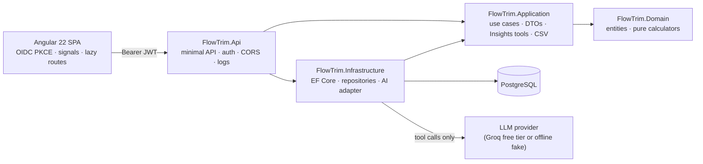

# FlowTrim — Portfolio Guide

A short, honest path to understand and verify FlowTrim in about five minutes.

| Repository | What it holds | CI |
|---|---|---|
| [FlowTrim-backend](https://github.com/Andermc10/FlowTrim-backend) | .NET 10 API, domain formulas, PostgreSQL, Insights |  |
| [FlowTrim-frontend](https://github.com/Andermc10/FlowTrim-frontend) | Angular 22 SPA, landing, browser flow |  |
| FlowTrim-tracker (this repo) | Specs, backlog, acceptance evidence, runbooks | — |

## 1. The problem

Small recurring charges (streaming, cloud storage, gym, phone, instalments) add up quietly, and most people do not
know what they can still spend this month once those charges are counted. FlowTrim is a personal-finance workspace
where a person records **their own** accounts and transactions, lists every recurring payment and sees, with the
formula next to every number:

- how much they can spend per day until the month ends ("safe to spend today");
- the real monthly and annual cost of their recurring payments and what cutting some would save;
- budgets per category, savings goals and a monthly statement against the previous month;
- answers to plain questions, where the AI explains numbers it did not calculate.

## 2. Data honesty (the product rule)

| Kind of data | What it means in FlowTrim | Never presented as |
|---|---|---|
| **Recorded transaction** | Income, expense or transfer the user entered or imported from their own bank CSV | — |
| **Expected charge** | Projected from a recurring payment's next date and cycle | A payment. It becomes one only when the user marks it as paid **with an account**, which records an expense |
| **Declared usage / goal contribution** | What the user says they used or set aside | Verified usage, or money moved |
| **Estimate** | Safe to spend today, annual projection, savings, goal completion month | A guarantee or financial advice; the assumptions are always shown |

FlowTrim never connects to banks, never detects charges and never cancels anything.

## 3. Architecture

- **Layered modular monolith**: one deployable backend; project references enforce `Api → Application → Domain` and
  `Infrastructure → Application/Domain`; `Domain` depends on nothing.
- **Pure calculators** hold every money rule (`RecurrenceSchedule`, `DailyAllowanceCalculator`, `BudgetCalculator`,
  `GoalCalculator`, `MonthlyStatementCalculator`, …) with an injectable clock and explicit rounding.
- **PostgreSQL** with `snake_case`, `CHECK` constraints and composite owner foreign keys, one migration per change.
- **Spec-Driven Development**: every story has a spec in [`specs/`](../specs) with Given/When/Then criteria; code and
  tests derive from it and the spec is reconciled after delivery.

## 4. Security boundary

- **OIDC Authorization Code + PKCE** in the browser (Auth0 in development); the API validates JWTs and fails fast
  without `Authority`/`Audience`.
- **Owner isolation**: every row has `owner_id` = token `sub`; every query filters by it; another user's id answers
  `404`, exactly like a missing one. Composite foreign keys `(owner_id, …)` stop a transaction from pointing at another
  user's account or category even in the database.
- CORS with exact `https://` origins outside Development, HSTS, RFC 7807 errors without stack traces, JSON logs with a
  correlation id and without personal data or SQL text.
- No secrets in Git (User Secrets / environment variables); CI runs with `contents: read` and no secrets.

## 5. AI boundary

- The model can only call **eight allow-listed, read-only C# tools** (summary, upcoming charges, simulation, cost per
  use, analytics, month spending, budgets, goals). It cannot run SQL, see ids, owner or token, or call anything else.
- The **figures** in a response are built by the backend from the tool results, never parsed from the model's text;
  if no tool ran, the model's text is discarded.
- Per-owner rate limit, request budget and safe `429`/`502`/`504` errors. The question and answer are never logged.
- Verified by [`INSIGHTS-VERIFICATION.md`](INSIGHTS-VERIFICATION.md): figures equal the deterministic screens even
  when the model text lies.

## 6. Quality evidence

| Evidence | Where |
|---|---|
| 766 backend tests (unit, HTTP, PostgreSQL via Testcontainers) | backend `dotnet test` · CI on every PR |
| 249 frontend unit tests, ESLint, production build | frontend `npm test` · CI on every PR |
| Browser flow on the real API + PostgreSQL with a local OIDC issuer | frontend `npm run e2e` ([e2e/README.md](https://github.com/Andermc10/FlowTrim-frontend/blob/main/e2e/README.md)) |
| Acceptance runs, one row per verified epic/story | [`E2E-ACCEPTANCE.md`](E2E-ACCEPTANCE.md) (29 rows) |
| Protected `main` (a red check cannot merge) | [`CI.md`](CI.md) |
| Operations runbook (correlation id, logs, health) | [`OPERATIONS.md`](OPERATIONS.md) |
| Screenshots | [frontend README](https://github.com/Andermc10/FlowTrim-frontend#screenshots) |

## 7. Deployment status

**There is no public deployment.** The project has no budget and the free hosting story (HU-40) was deferred by the
owner. Everything runs locally: PostgreSQL in Docker Compose, the API on `http://localhost:5214` and the SPA on
`http://localhost:4200` (see each README's quick start). The browser flow (`npm run e2e`) starts the whole stack with a
local test issuer, so no Auth0 tenant or AI key is needed to verify it.

## 8. Five-minute demo (local)

Prerequisites: Docker Desktop, .NET 10 SDK, Node 22.22.3+, an OIDC tenant (or `npm run e2e` for the automated version).

1. **Landing** (`/`): the daily story; switch theme and language (EN/ES).
2. **Sign in** → **Today** (`/app`): safe to spend today per currency; open the formula and its inputs.
3. **Quick add**: press **N**, record an expense of 35,000 COP in Food → Today and the account balance change.
4. **Recurring payments**: add a weekly water bill with an `https://` payment link and a 2-instalment laptop plan;
   **Mark as paid** the bill with an account → the expense appears in Transactions; the plan shows its progress
   ("1 of 2 paid") once its first instalment is marked.
5. **Calendar**: the month with expected charges next to recorded spending; an expected charge is not a payment.
6. **Budgets**: a 40,000 COP Food budget shows 87.5 % and "Close to the limit" (also on Today).
7. **Goals**: a trip goal with a contribution; needed per month and estimated completion are labelled estimates.
8. **Analytics & reports → Statement**: income, expenses, net and top categories against the previous month.
9. **AI Assistant**: ask "How are my budgets?" → the Spent figure equals the budgets page; open the source link.
   Ask "Tell me a joke" → unsupported, no invented numbers.
10. **Sign out**; a second account sees none of this data.

## 9. Known limitations and deferred work

- Manual data only: no bank connection, no charge detection, no usage verification; bank import is a user-provided CSV.
- No currency conversion: every total is per currency.
- Estimates assume constant prices and no other income or expenses.
- No public deployment (HU-40 deferred) and therefore no e-mail digest or Web Push (phase 4 needs hosting and an
  e-mail provider).
- The UI is English and Spanish; dates follow the America/Bogota calendar.
- Deferred technical items: backend and frontend `docs/TECH-DEBT.md`.
